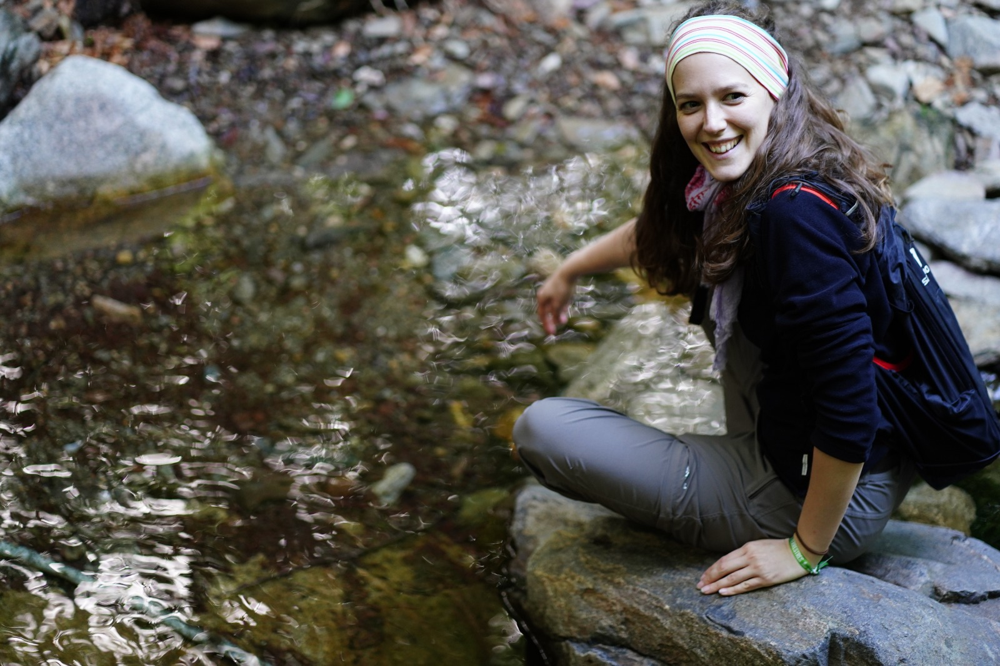
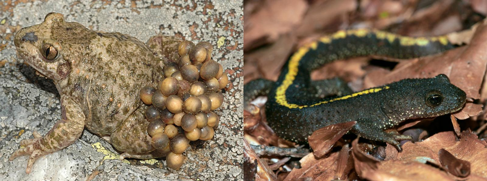
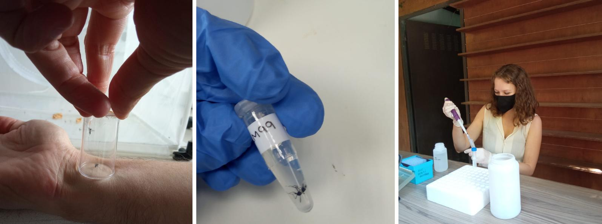
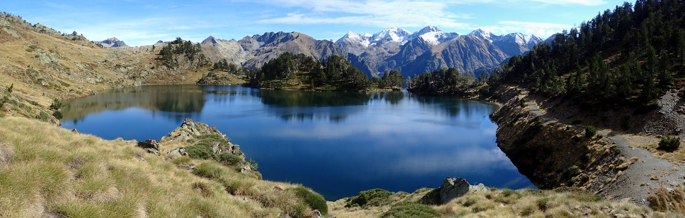

Avui coneixem a la Federica Lucati. Ella és graduada en Ciències Naturals a la Universitat de Padua (Itàlia) i té un màster en Ciències Naturals.El passat mes de juny va presentar la seva tesi doctoral titulada: Linking phylogeography and recent dispersal in high mountains: Insights from two Iberian amphibians, dirigida pel Dr. Marc Ventura del Centre d’Estudis Avançats de Blanes (CEAB-CSIC) i pel Prof. Rui Rebelo del Centre for Ecology, Evolution and Environmental Changes (cE3c) de la Universitat de Lisboa.

Actualment és una investigadora postdoc en el projecte Human-Mosquito Interaction Project finançat per l’European Research Council (ERC) i coordinat pel Prof. John Palmer de la Universitat Pompeu Fabra (UPF) de Barcelona i codirector de Mosquit Alert, en col·laboració amb el Centre d’Estudis Avançats de Blanes (CEAB-CSIC).

Imatge 1. Federica Lucati

**Abans de res i en línies molt generals, què és el que et va seduir de la ciència que et va portar a embarcar-te a fer un doctorat?**

Sempre m’ha agradat la ciència, des de petita tenia curiositat per saber el perquè de les coses, però la veritat és que l’oportunitat de fer un doctorat va sortir per casualitat des de l’altra punta de món. Vaig estar una temporada treballant a les Illes Seychelles com a assistent de treball de camp, quan el meu responsable un dia em va parlar d’una convocatòria de doctorat a Portugal, vaig aplicar i al cap d’uns mesos era a la Universitat de Lisboa amb una beca de doctorat.

**Podries explicar-nos breument en què s’ha centrat la teva tesi doctoral? Quina pregunta buscaves resoldre? Ho has aconseguit?**

La meva tesi doctoral s’ha centrat en l’estudi de les poblacions d’alta muntanya (sobretot als Pirineus) de dues espècies d’amfibis, el tritó pirinenc Calotriton asper, i el tòtil, gripau llevadora o gripau paridor, Alytes obstetricans, a través d’eines genètiques. Es tractava d’entendre quins són els principals processos històrics i recents que podrien ser responsables de la distribució geogràfica i de l’estructura genètica contemporània de les dues espècies.

Vaig aconseguir entendre millor el paper de les glaciacions i de les oscil·lacions climàtiques en la història evolutiva de les espècies d’estudi, i com els patrons de dispersió actual es veuen afectats per factors d’amenaça tal com la introducció d’espècies exòtiques en el cas del tritó pirinenc i les malalties emergents en el cas del tòtil.

Tota aquesta informació és fonamental per al desenvolupament d’estratègies efectives per a la conservació de les espècies.

Imatge 2. Esquerra: Tòtil. Autor: Jaume Bosch. Dreta: Tritó pirinenc. Autora: Claudine Delmas.

**Quines han estat les principals dificultats que t’has trobat al llarg de les teves investigacions?**

Les principals dificultats me les vaig trobar durant el doctorat, que ha posat a prova la meva capacitat d’adaptació i de resiliència. Durant el meu primer any de doctorat a Lisboa, vaig tenir un accident de cotxe que em va obligar a suspendre el doctorat durant un any i mig. Després vaig haver de tornar a començar des de zero al CEAB.

Evidentment també hi ha les dificultats típiques del doctorat, com anàlisis de laboratori que fallen i s’han de repetir diverses vegades, reptes en l’anàlisi de dades, revisors de revistes molt durs i crítics, i la burocràcia que pot causar més problemes que la mateixa tesi.

**Quines coses que saps ara en relació amb el doctorat t’hauria agradat saber abans de començar-lo?**

M’havien dit que el doctorat seria dur, però no pensava que m’enfrontaria a tants obstacles. L’elecció de director de tesi és segurament fonamental, i jo, al CEAB (que és on a la final vaig fer la major part del doctorat) vaig tenir la sort de trobar-ne un de molt bo.

**Ens comentes que actualment estàs realitzant un programa de postdoctorat. Quina és llavors la teva línia d’investigació actualment?**

M’ocupo d’estudiar les xarxes d’interaccions humà-mosquit tigre, a través d’anàlisis genètiques de la sang humana de l’estómac dels mosquits i la saliva de voluntaris d’una regió/zona determinada. Els mosquits són una excel·lent font d’informació sobre les persones que piquen.

> Analitzant la sang trobada a l’estómac dels mosquits podem arribar a contestar preguntes com, per exemple: A quantes persones pica un mosquit? Hi ha persones més susceptibles a ser picades?, ens explica la Federica.

D’altra banda, les persones també són una excel·lent font d’informació sobre els mosquits que els piquen. Els perfils genètics trobats a la sang dels mosquits es creuaran amb els de les mostres de saliva dels voluntaris, per saber si la sang correspon a algun dels voluntaris, i poder així reconstruir la xarxa d’interaccions i arribar a saber quants i quines espècies de mosquits han picat a cada persona.

Imatge 3. Federica Lucati fent experiments amb mosquits tigre.

**Per què creus que és rellevant l’estudi dels mosquits transmissors de malalties? Per què és important saber a qui piquen o quantes vegades piquen?**

El mosquit tigre és un important vector de malalties com el Dengue, el Zika o la febre Chikungunya. Els nostres resultats permetran desenvolupar sistemes més precisos de predicció en temps real del risc de transmissió de les malalties transmeses pel mosquit tigre.

> Saber a qui piquen o quantes vegades piquen els mosquits ens dona una estima de la taxa d’interacció entre humans i mosquits, que és uns dels paràmetres més importants a l’hora de determinar el risc de malalties segons molts models matemàtics, comenta la Federica.

Amb els resultats obtinguts es vol contribuir a la millora dels models epidemiològics actuals.

**Com és el teu dia a dia a la feina?**

Durant el doctorat, el meu treball va estar constituït per 3 etapes principals: recol·lecció de mostres al Pirineu durant unes 3 setmanes a l’estiu, anàlisi de les mostres al laboratori de genètica i anàlisi de dades, que és l’etapa que ocupava la major part de les meves hores laborals.

Imatge 4. Llac Naorte. Autor: Marc Ventura, Projecte LIFE-Limnopirineus

Ara, a causa de la pandèmia, teletreball a l’almenys dos/tres dies per setmana. A més, pas molt menys temps al laboratori, ja que el meu treball està més enfocat en anàlisi de dades, escriptura d’articles científics, coordinació i comunicació amb els diferents sectors de l’equip de Mosquit Alert.

**Què és el que més t’agrada de la teva feina?**

En general, m’encanta l’obertura mental i l’ambient interdisciplinari i multicultural de la ciència. Gairebé sempre els projectes científics són col·laboratius, així que la investigació ofereix moltes oportunitats de viatjar i entrar en contacte amb personal científic de tot el món.

**I fora de la feina, què t’agrada fer quan no camines entre pipetes o davant de l’ordinador?**

Fora de la feina m’agrada dedicar-me als meus projectes científics extralaborals, aprendre nous idiomes (ara, per exemple vaig a classes de català), vendre coses en línia, viatjar, sortir amb els meus amics/parella.

**Com et veus d’aquí a 10 anys? T’agradaria seguir en el món de la investigació científica?**

No acostumo a pensar molt en el meu futur laboral, només sé que m’agrada la ciència i m’agradaria seguir fent recerca, tot i que la precarietat en ciència ho fa complicat. Tinc clar que vull ascendir en la meva feina, en el futur m’agradaria liderar els meus propis projectes de recerca i tant de bo el meu propi equip, i també tenir més oportunitats de viatjar i col·laborar amb diferents grups d’investigació.

**Si haguessis de descriure en una paraula o frase curta el projecte de Mosquit Alert, què diries?**

Multidisciplinari i innovador… és l’hòstia! 😉

*Aquesta entrada també es publica al [blog de Mosquito Alert](http://www.mosquitoalert.com/ca/els-mosquits-son-una-excel·lent-font-dinformacio-sobre-les-persones-que-piquen-ens-explica-la-federica-lucati/)*

